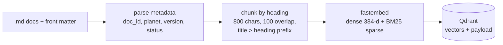
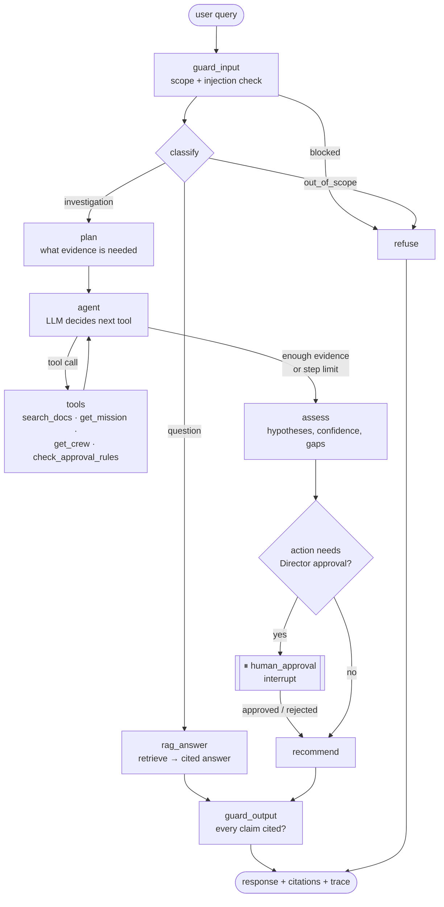
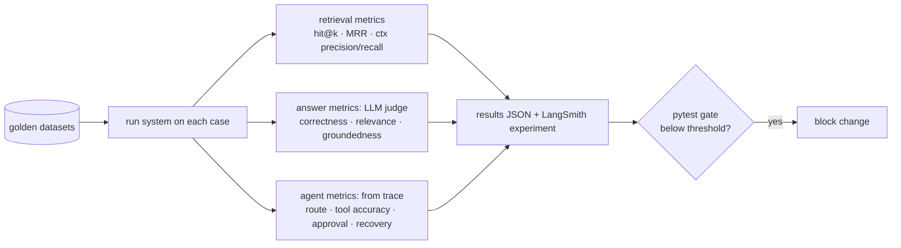

# Odyssey: Workflow and Data Structures

Diagrams are Mermaid (render on GitHub and in VS Code's Markdown preview). The same diagrams are shown on the Lab site.

## 1. Who does what (tools vs roles)
| Stage | Tool | What it is |
|---|---|---|
| Chunking | **our code** (`app/chunking.py`) | Splits docs at headings into ~800-char pieces with overlap |
| Embedding | **fastembed** + `bge-small` | A *model runner*, not a DB. Turns text → 384 numbers (meaning) |
| Keyword vectors | **fastembed** + `Qdrant/bm25` | Turns text → sparse word-weight vector (exact terms) |
| Storage + search | **Qdrant** | The *vector database*: stores vectors + metadata, finds nearest neighbours fast (HNSW index), filters, fuses dense + keyword results |
| Reranking | **fastembed** + `bge-reranker-v2-m3` | Re-reads (question, chunk) pairs together and re-scores the top 20 |
| Generation | **Groq** `gpt-oss-120b` | Writes the cited answer / drives the agent |
| Orchestration | **LangGraph** | Runs the multi-step agent: state, routing, loops, pause/resume |
| Judging | **DeepSeek** `deepseek-flash` | Grades answers in evals |

## 2. Indexing (offline)

Re-ingesting a file deletes its old chunks first → no stale versions.

## 3. Request flow (online), the LangGraph graph

- **Conditional edges**: `classify`, the agent ⇄ tools loop, `needs approval?`
- **Cycle**: agent ⇄ tools until enough evidence (capped at 6 steps)
- **Interrupt**: graph state is checkpointed; the run waits for a human, then resumes with the same `thread_id`
- **Retries**: LLM nodes retry with backoff; tool errors are returned to the agent as messages so it can recover

## 4. The graph state (the data structure every node reads/writes)
```python
class Evidence(TypedDict):
    doc_id: str; text: str; score: float; via: str      # via = "search_docs" | "get_mission" ...

class ToolCall(TypedDict):
    name: str; args: dict; ok: bool; ms: int

class Assessment(BaseModel):
    summary: str
    hypotheses: list[str]          # ranked
    confidence: Literal["low", "medium", "high"]
    gaps: list[str]                # what evidence is missing
    proposed_action: str
    needs_approval: bool
    approval_reason: str

class TraceEvent(TypedDict):
    node: str; ms: int; summary: str                     # observable events, no hidden reasoning

class OdysseyState(TypedDict):
    query: str
    route: Literal["question", "investigation", "out_of_scope", "blocked"]
    messages: Annotated[list, add_messages]              # LLM ⇄ tool conversation (reducer: append)
    evidence: Annotated[list[Evidence], operator.add]    # accumulates across loop iterations
    tool_calls: Annotated[list[ToolCall], operator.add]
    assessment: Assessment | None
    approval: Literal["pending", "approved", "rejected"] | None
    answer: str | None
    citations: list[str]
    steps: int                                           # loop guard
    trace: Annotated[list[TraceEvent], operator.add]     # feeds the visualizer + agent evals
```
**Reducers** (`Annotated[..., operator.add]`) tell LangGraph to *append* a node's output instead of overwriting, which is how evidence and the trace build up over the loop.

## 5. How state changes through one investigation
| Step | Node | State written |
|---|---|---|
| 1 | guard_input | `route` stays unset, trace += "input ok" |
| 2 | classify | `route = "investigation"` |
| 3 | plan | `messages += plan` |
| 4–7 | agent ⇄ tools | `tool_calls += …`, `evidence += …`, `steps += 1` |
| 8 | assess | `assessment = {hypotheses, needs_approval: true, …}` |
| 9 | human_approval | `approval = "pending"` → **paused**, checkpoint saved |
| 10 | (resume) | `approval = "approved"` |
| 11 | recommend | `answer`, `citations` |
| 12 | guard_output | verifies citations ⊆ evidence doc_ids |

## 6. Where evaluation hooks in

